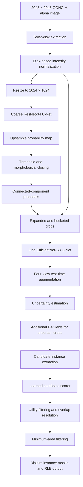

# Solar Filament Instance Segmentation

### MAGFiLO 2026 · Solar Filament Segmentation Challenge

**Task:** Instance segmentation of solar filaments in full-disk GONG H-alpha observations  
**Input resolution:** 2048 × 2048  
**Framework:** PyTorch · U-Net · OpenCV · scikit-learn

A two-stage segmentation pipeline combining coarse localization, native-resolution crop refinement, uncertainty-guided test-time augmentation, and learned instance selection.

---

## 1. Overview

This project addresses instance segmentation of solar filaments in full-disk GONG H-alpha images. The pipeline separates the task into three stages:

1. **Proposal generation:** a coarse network identifies image regions that may contain filaments.
2. **High-resolution refinement:** a second network segments filament structures within crops extracted from those regions.
3. **Instance selection:** a learned scorer ranks candidate components, followed by overlap resolution and mask cleanup.

This coarse-to-fine design avoids applying computationally expensive, high-resolution inference uniformly across the entire solar image. It also treats pixel-level segmentation and instance-level decision-making as separate problems.

The final submission notebook loads pretrained neural-network checkpoints and a matching candidate-scorer bundle. It performs inference and validation-time recipe selection; it does not train the two neural networks during the final submission run.

## 2. Results

| Evaluation | Result | Description |
|---|---:|---|
| **Public leaderboard** | **0.35 PQ** | Score reported for the submitted solution |
| Local validation | 0.4195 PQ | 141-image development split |
| Validation SQ | 0.6705 | Segmentation quality |
| Validation RQ | 0.6256 | Recognition quality |
| Test submission | 1,202 instances | 180 hidden-test images |

### Final validation comparison

The final shortlist compared two inference recipes using the same candidate scorer and threshold.

| Recipe | PQ | SQ | RQ | TP | FP | FN |
|---|---:|---:|---:|---:|---:|---:|
| N1 — standard four-view inference | 0.419335 | **0.670849** | 0.625081 | 962 | 523 | 631 |
| **N4 — uncertainty-routed midpoint median** | **0.419490** | 0.670532 | **0.625608** | **965** | 527 | **628** |

N4 was selected because it achieved the higher pooled validation PQ. The difference was only 0.000155, so it should be interpreted as a marginal improvement within this shortlist rather than a substantial or independently established gain.

The public leaderboard score and local validation score come from different evaluation sets and should be reported separately.

### Submission checks

The final run completed on two NVIDIA T4 GPUs in 1,409.6 seconds. The generated submission contained 1,202 instances across 180 test images. The output audit found:

- No duplicate instance IDs or missing required fields.
- No unknown image IDs or empty decoded masks.
- No RLE decoding errors or within-image overlap pixels.
- Four test images with no emitted instances. Without hidden-test annotations, these images cannot be assumed to be filament-free.

---

## 3. Pipeline

## 4. Methodology and design rationale

### 4.1 Solar-disk-aware normalization

The image contains a bright solar disk surrounded by a large dark background. Computing intensity statistics over the entire frame would make the normalization sensitive to the amount of background. The pipeline first extracts the disk using Otsu thresholding and the largest foreground connected component. It then calculates the median and median absolute deviation (MAD) inside the disk:

$$
I_{\mathrm{norm}} =
\frac{I-\operatorname{median}(I_{\mathrm{disk}})}
{\operatorname{MAD}(I_{\mathrm{disk}})+10^{-6}}.
$$

**Rationale.** Median and MAD are robust to extreme pixel values. Restricting their calculation to the solar disk prevents the surrounding background from dominating the intensity statistics and provides a more consistent input scale.

### 4.2 Coarse localization

A one-channel **ResNet-34 U-Net** processes the full image at 1024 × 1024. Its probability map is resized to 2048 × 2048 before thresholding, morphological closing, and connected-component extraction. The final configuration uses:

- Coarse probability threshold: **0.30**
- Minimum proposal area: **20 pixels**
- Morphological closing kernel: **45 pixels**

The coarse stage prioritizes spatial coverage over precise boundaries. Its purpose is to identify plausible filament regions while reducing the area that must be processed by the more expensive refinement network.

**Rationale.** Full-resolution segmentation over every pixel would increase memory and computation requirements. Coarse localization narrows the search space, while upsampling the probability map before thresholding preserves more flexibility in the geometry of the resulting proposals.

### 4.3 Native-resolution crop refinement

Each coarse proposal is expanded by 32 pixels and paired with a dilated proposal-region mask. Crops are assigned to fixed canvas sizes:

- Widths: `160, 288, 576, 928`
- Heights: `160, 256, 448, 800`

A two-channel **EfficientNet-B3 U-Net** receives the normalized image crop and its proposal-region mask. The image channel provides the solar texture; the mask supplies spatial context about the region proposed by the coarse stage.

Fixed crop buckets make batching more predictable and reduce inefficient shape changes. They also bound memory consumption without forcing all proposals into one large input size.

EfficientNet-B3 was selected following an earlier architecture comparison. In that study, the BCE + Dice configuration achieved a full-validation PQ of **0.4443** and a clean-holdout PQ of **0.4283**, outperforming the other tested fine-model variants. These figures belong to the preceding architecture study, not the final submission run.

### 4.4 Uncertainty-guided test-time augmentation

The standard fine-inference path averages four aligned views:

- Identity
- Horizontal flip
- Vertical flip
- 180-degree rotation

Variation between the aligned probability maps provides an uncertainty signal. The most uncertain 20% of crops receive additional inference using all eight transformations in the D4 symmetry group. Their aligned predictions are aggregated using the midpoint of the two central sorted values.

**Rationale.** Additional inference is concentrated on crops where the initial predictions disagree, rather than being applied uniformly. This controls the computational cost of test-time augmentation. In the final validation shortlist, the N4 recipe reached 0.419490 PQ compared with 0.419335 for N1. The observed gain was marginal; the principal design motivation is targeted allocation of inference compute.

### 4.5 Learned instance scoring and overlap resolution

Pixel confidence alone does not fully describe whether a connected component is a useful instance. Each candidate is represented by eight features:

`log_area`, `mean_prob`, `max_prob`, `std_prob`, `aspect_ratio`, `extent`, `norm_radius`, and `tortuosity`.

A two-part histogram-gradient-boosting **hurdle scorer** estimates:

1. Whether a candidate is likely to exceed the strict IoU eligibility threshold.
2. Its expected best-annotator IoU, conditional on being eligible.

The two estimates are combined into an expected-utility score. This provides an instance-level selection signal rather than relying only on average pixel probability.

The final run reused a fingerprint-matched scorer bundle and applied a threshold of **τ = 0.25**. Candidates are processed in descending utility order. Pixels already assigned to a higher-ranked candidate are removed from later overlapping candidates. Components smaller than 75 pixels are discarded before RLE encoding.

**Rationale.** This stage targets false-positive and fragmented instances after pixel-level segmentation. Greedy conflict resolution produces disjoint masks for the final submission. The scorer's target is best-annotator utility, not annotator consensus.

---

## 5. Dataset and evaluation

The challenge data contains 707 physical training observations and 180 hidden-test observations. Images are represented at 2048 × 2048 resolution. The notebook loads the COCO-style annotation JSON and uses a fixed split grouped by **physical observation ID**, ensuring that annotation records belonging to the same physical observation remain in the same partition.

| Partition | Physical images | Annotator records |
|---|---:|---:|
| Training | 566 | 937 |
| Validation | 141 | 217 |
| Hidden test | 180 | — |

The validation partition contains 1,593 ground-truth filament instances. It was used for final recipe selection and informed earlier experiments; it is therefore a development set, not an untouched test set.

### Panoptic Quality

Evaluation uses strict one-to-one matching. A predicted instance and a ground-truth instance are eligible to match only when their intersection over union (IoU) is greater than 0.5. Hungarian assignment maximizes the number of eligible matches and then the total matched IoU.

$$
\mathrm{PQ} =
\frac{\sum_{(p,g)\in TP}\mathrm{IoU}(p,g)}
{|TP|+\frac{1}{2}|FP|+\frac{1}{2}|FN|}
=
\mathrm{SQ}\times\mathrm{RQ}.
$$

Here, SQ measures segmentation quality and RQ measures recognition quality. PQ therefore penalizes inaccurate boundaries as well as missed and spurious instances. Candidate selection and overlap handling are consequently important in addition to pixel-level segmentation accuracy.

---

## 6. Reproducing the final run

The final notebook is designed for execution in Kaggle.

1. Attach the **MAGFiLO 2026 Solar Filament Segmentation Challenge** dataset.
2. Attach the external checkpoint dataset used by the final notebook.
3. Enable T4 GPU acceleration. The final run used two visible T4 GPUs through `DataParallel`.
4. Keep the coarse and fine model modes set to `load`, and the scorer mode set to `auto`.
5. Run all cells and submit the generated `submission.csv` from the new run directory. The notebook also mirrors the file to `/kaggle/working/submission.csv`.

### Required external assets

The final run loads pretrained weights and a matching scorer rather than training the neural networks:

| Asset | Purpose |
|---|---|
| `coarse_model_3.pth` | ResNet-34 coarse U-Net weights |
| `EXP_4_EfficientNetB3_BCE_Dice.pth` | EfficientNet-B3 fine U-Net weights |
| Matching candidate-scorer pickle bundle | Eight-feature hurdle scorer |
| `results8/split.json` | Physical-image train/validation split |

The notebook checks the scorer fingerprint against the active model and preprocessing configuration before reusing it. If a matching scorer is unavailable, `scorer_mode="auto"` can rebuild it from training-side candidates, which is a more expensive path. The final logged run reused the matching bundle and did not refit the scorer.

The bootstrap cell checks for `segmentation-models-pytorch==0.6.0` and `pycocotools`, installing them when necessary or using attached wheel files when available.

---

## 7. Reproducibility notes and limitations

- **Checkpoint provenance:** the training/validation membership of the two loaded neural-network checkpoints could not be independently established from the available metadata. It is therefore recorded as unknown rather than described as verified out-of-fold training.
- **Scorer provenance:** the reused scorer metadata records training-side candidate construction on 566 physical images and confirms that validation targets were not used to fit the scorer. However, `model_level_oof` is recorded as `false`; this is not a model-level out-of-fold scorer.
- **Validation selection:** N1/N4 selection was performed on the 141-image development split. The reported validation PQ is selection-dependent and should not be treated as an unbiased estimate of hidden-test performance.
- **Leaderboard and validation:** the public leaderboard score (0.35) and local validation PQ (0.4195) come from different evaluation sets.
- **Hidden-test labels:** the notebook verifies CSV structure, RLE decoding, image geometry, and non-overlap. It cannot establish whether the four zero-prediction test images contain filaments.

## 8. Acknowledgement

This work was carried out for the **MAGFiLO 2026 Solar Filament Segmentation Challenge**, using GONG H-alpha observations and the challenge annotations. GONG observations are provided through the NSO Integrated Synoptic Program and its participating observatory network.

## 9. Technical report

The accompanying technical report describes the methodology, validation protocol, and measured results.

---

*MAGFiLO 2026 · Solar Filament Instance Segmentation*
