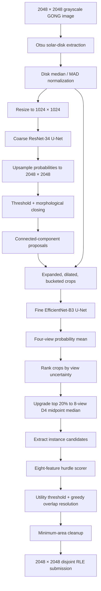

# ☀️ SolarCrow 10

### Instance Segmentation of Solar Filaments in GONG H-alpha Images

**Solar Filament Segmentation Challenge 2026 · MAGFiLO**  
**Farhan Anjum · Department of Computer Science & Engineering, BUET**

*A coarse-to-fine segmentation system with uncertainty-routed test-time augmentation and learned candidate selection.*

---

## Overview

**SolarCrow 10** is a two-stage instance-segmentation pipeline built for full-disk, 2048 × 2048 GONG H-alpha solar observations. It first identifies likely filament regions across the solar disk, then refines those regions at native crop resolution. A lightweight, learned candidate scorer ranks the resulting instances before overlap resolution and RLE export.

The final submission uses pretrained segmentation checkpoints rather than training the neural networks during the submission run. The notebook reuses a fingerprint-matched candidate scorer, evaluates a small inference shortlist on the development split, and applies the selected recipe unchanged to the hidden test images.

## Results

| Evaluation | Result | Details |
|---|---:|---|
| **Public leaderboard** | **0.35 PQ** | Final score reported for the submitted solution |
| Local validation | **0.4195 PQ** | 141-image development split; N4 midpoint recipe selected |
| Validation SQ | 0.6705 | Segmentation quality |
| Validation RQ | 0.6256 | Recognition quality |
| Test submission | 1,202 instances | 180 hidden-test images; 176 images received at least one predicted instance |

The final notebook compared two primary recipes using the same candidate scorer and threshold:

| Recipe | PQ | SQ | RQ | TP | FP | FN |
|---|---:|---:|---:|---:|---:|---:|
| N1 — standard four-view inference | 0.419335 | **0.670849** | 0.625081 | 962 | 523 | 631 |
| **N4 — uncertainty-routed midpoint median** | **0.419490** | 0.670532 | **0.625608** | **965** | 527 | **628** |

N4 was selected because it produced the highest pooled validation PQ. Its margin over N1 is small, so the result should be read as a validation-selected improvement rather than evidence of a large or independently confirmed gain. The **0.35 public leaderboard score** is a separate competition evaluation; it is not the local validation score.

### Submission integrity

The final run completed on **two NVIDIA T4 GPUs** in 1,409.6 seconds. The serialized CSV audit reported:

- 1,202 decoded instance masks across 180 test images.
- 0 duplicate instance IDs, 0 missing fields, and 0 unknown image IDs.
- 0 empty decoded masks, 0 decode errors, and 0 images with overlapping instance masks.
- 4 test images had no emitted instances. Without hidden-test annotations, these cannot be interpreted as genuinely filament-free images.

---

## Pipeline

### 1. Solar-disk preprocessing

Images are read as grayscale. Global Otsu thresholding separates the solar disk from the background; the largest foreground connected component is retained as the disk mask. Intensity normalization is restricted to that disk:

\[
I_{norm}=\frac{I-\operatorname{median}(I_{disk})}
{\operatorname{MAD}(I_{disk})+10^{-6}}.
\]

This provides a robust intensity scale while avoiding background pixels influencing the image statistics.

### 2. Coarse proposal network

A **one-channel ResNet-34 U-Net** operates on 1024 × 1024 images. Its probabilities are bilinearly resized to the native 2048 × 2048 grid before thresholding. The final run uses a 0.30 coarse threshold, 20-pixel proposal-area floor, and 45-pixel morphological closing kernel. Four-view test-time augmentation is used for the coarse stage.

### 3. Fine crop segmentation

Each proposal is expanded by 32 pixels and paired with a dilated region mask. Crops are snapped to fixed width buckets `{160, 288, 576, 928}` and height buckets `{160, 256, 448, 800}`. A **two-channel EfficientNet-B3 U-Net** receives:

1. the normalized image crop; and
2. the binary proposal-region mask.

Ordinary fine inference averages aligned probabilities from four views: identity, horizontal flip, vertical flip, and 180° rotation. The mean per-pixel variance across views supplies a crop-level uncertainty score. The most uncertain 20% of primary crops are routed through all eight D4 transformations; their aligned probabilities are combined using the midpoint of the two central sorted values, followed by the measured float16 rounding step. The fine threshold is 0.50.

### 4. Candidate scoring and cleanup

Every candidate is described by eight features:

`log_area`, `mean_prob`, `max_prob`, `std_prob`, `aspect_ratio`, `extent`, `norm_radius`, and `tortuosity`.

The **hurdle scorer** estimates the probability that a candidate clears the strict IoU eligibility threshold, multiplied by its expected best-annotator IoU when eligible. It is implemented with a classifier and conditional regressor. Candidates below utility threshold **τ = 0.25** are removed; the remaining candidates are ranked by utility and resolved greedily so that emitted instances do not overlap. Components smaller than **75 pixels** are discarded before RLE serialization.

The scorer's target is **best-annotator utility**, not annotator consensus.

---

## Dataset and evaluation

The challenge data contains 707 physical training observations and 180 hidden-test observations, each represented at 2048 × 2048 resolution. The notebook loads the COCO-style annotation JSON and uses a fixed split grouped by **physical observation ID**, so multiple annotator records for one solar observation remain in the same partition.

| Partition | Physical images | Annotator records |
|---|---:|---:|
| Training | 566 | 937 |
| Validation | 141 | 217 |
| Hidden test | 180 | — |

The validation partition contains 1,593 ground-truth filament instances. The final run uses it for recipe selection; it has also informed previous experiments, so it is **not an untouched test set**.

### Panoptic Quality

Evaluation uses strict one-to-one matching: a prediction and ground-truth instance are eligible only when **IoU > 0.5**. The Hungarian assignment maximizes the number of eligible matches first, then the total matched IoU.

\[
\mathrm{PQ}=\frac{\sum_{(p,g)\in TP}\mathrm{IoU}(p,g)}
{|TP|+\frac12|FP|+\frac12|FN|}
=\mathrm{SQ}\times\mathrm{RQ}.
\]

This avoids counting multiple predictions against the same ground-truth object as separate true positives.

---

## Reproducing the final Kaggle run

The submitted notebook is designed to run in Kaggle.

1. Attach the **Solar Filament Segmentation Challenge 2026** competition dataset.
2. Attach the external checkpoint dataset containing the required SolarCrow assets (the final run used `fanzzum/solarcrow8d`).
3. Enable a **T4 GPU**; the final run used two visible T4 GPUs through `DataParallel`.
4. Keep the final submission settings in `load` mode for both neural networks, with scorer mode set to `auto`.
5. Run all cells. Submit the generated `submission.csv` from the new run directory (the notebook also mirrors it to `/kaggle/working/submission.csv`).

### External assets

The final run loaded these assets rather than training new neural checkpoints:

| Asset | Purpose |
|---|---|
| `coarse_model_3.pth` | ResNet-34 coarse U-Net weights |
| `EXP_4_EfficientNetB3_BCE_Dice.pth` | EfficientNet-B3 fine U-Net weights |
| `candidate_scorer_solarcrow10.pkl` | Fingerprinted eight-feature hurdle scorer |
| `results8/split.json` | Physical-image train/validation split |

The notebook checks the scorer fingerprint against the active model and preprocessing configuration before reuse. If a matching scorer is unavailable, `scorer_mode="auto"` can rebuild it from training-side candidates; that is a more expensive path. The final logged run reused the matching scorer bundle and did not refit it.

The bootstrap cell checks for `segmentation-models-pytorch==0.6.0` and `pycocotools`, installing them when missing (or using attached wheel files when available). The final logged environment included Python 3.13.16, PyTorch 2.11.0+cu130, NumPy 2.1.3, OpenCV 4.14.0, scikit-learn 1.6.1, and SciPy 1.16.3.

---

## Reproducibility notes and limitations

- **External model provenance:** the training/validation membership of the two loaded neural checkpoints could not be independently established from the available metadata. The notebook records this as unknown rather than claiming verified out-of-fold weights.
- **Scorer provenance:** the reused scorer metadata records training-side candidate construction on 566 physical images and confirms that validation targets were not used to fit the scorer. However, `model_level_oof` is recorded as `false`; this is not a model-level out-of-fold scorer.
- **Validation selection:** N1/N4 selection was performed on the 141-image development split. Its PQ is therefore validation-selected and should not be presented as an unbiased estimate of hidden-test performance.
- **Leaderboard vs. validation:** the public leaderboard score (0.35) and local validation PQ (0.4195) come from different evaluation sets and should not be compared as if they were the same metric run.
- **Hidden-test labels:** the notebook verifies CSV structure, RLE decoding, image geometry, and non-overlap. It cannot establish whether the four zero-prediction test images contain filaments.

---

## Acknowledgements

This project was developed for the **Solar Filament Segmentation Challenge 2026**, organized by the Earth-Space AI Research (ESAIR) Lab. The work uses GONG H-alpha observations and the MAGFiLO challenge annotations. GONG observations are provided through the NSO Integrated Synoptic Program and its participating observatory network.

## Technical report

The accompanying four-page report describes the methodology, validation protocol, and measured results: [SolarCrow 10 — Technical Report](./solarcrow10_technical_report.pdf).

## Citation

If you use or build on this work, please cite the competition and dataset in accordance with the organizers' instructions.

---

**SolarCrow 10 · BUET · 2026**

